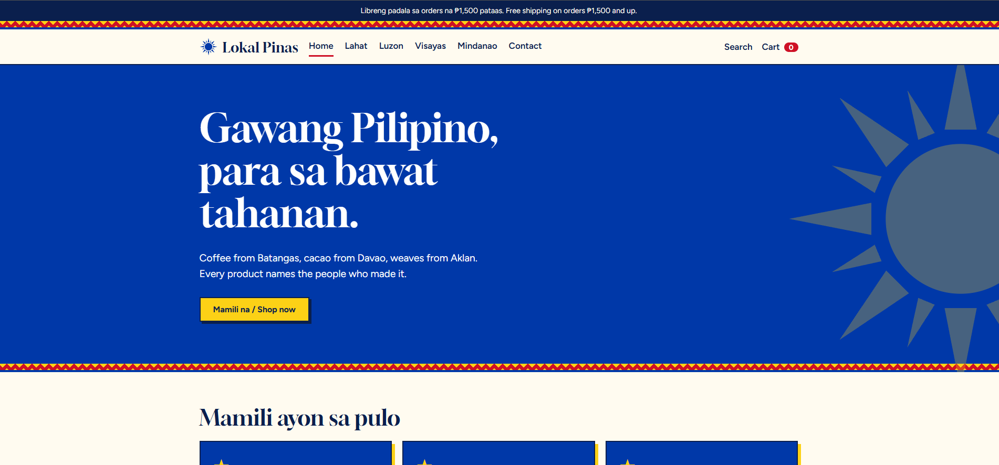
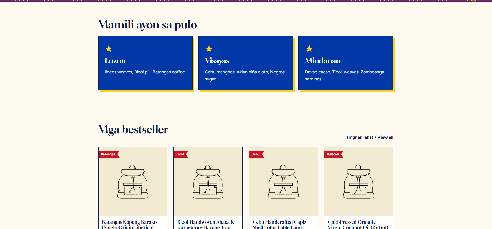
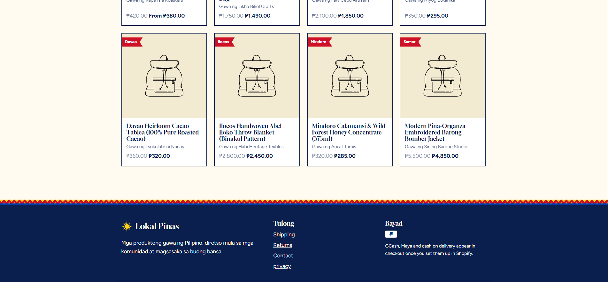
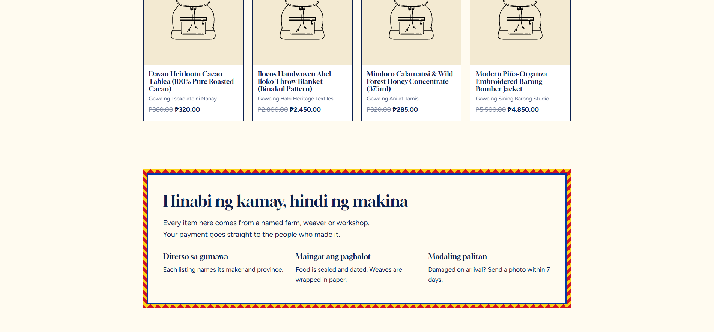
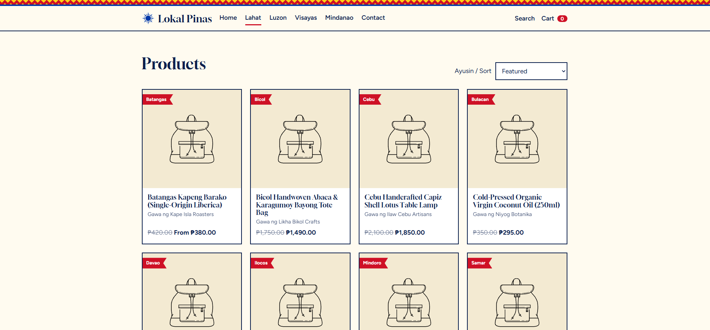

# Lokal Pilipinas: a Shopify theme for Filipino products

A custom Shopify Online Store 2.0 theme for selling Filipino-made products. The design draws on the Philippine flag (blue, red, yellow and the eight-rayed sun), the woven *banig* mat pattern, and the three stars that stand for Luzon, Visayas and Mindanao.

> Status: version 1.0.0, a starter theme. It was written without access to a live Shopify store, so run through the checks in `docs/SETUP-GUIDE.md` before launch.
## Live Preview & Screenshots

## What is included

| Area | What you get |
|---|---|
| Home page | Hero with sun and optional arch photo, three island-group cards, featured products, maker story with three pledges |
| Catalog | Collection page with sorting and pagination, product cards with origin ribbon and maker name, search page |
| Product page | Image gallery, variant picker, quantity, free-shipping note, product structured data for SEO |
| Cart | Quantity update, remove, free-shipping progress message |
| Theme editor | Colours, logo, favicon, social links, every home section editable |
| Other | Responsive layout, skip link, keyboard-friendly focus states, reduced-motion support |

## Quick start

1. Download `lokal-pilipinas-theme.zip` (theme files only) and upload it in Shopify: **Online Store → Themes → Add theme → Upload zip file**.
2. Follow `docs/SETUP-GUIDE.md` to add products, collections, menus, payments and shipping.

## Documentation

- `docs/SETUP-GUIDE.md`: setting up the Shopify store around this theme, including Philippine payments and shipping
- `docs/THEME-DOCS.md`: file structure, design tokens, customization and the list of outstanding work

## Product data this theme expects

- **Vendor** field = the maker, for example "Kalibo Weavers Guild". Shown as "Gawa ng …".
- **Metafield `custom.origin`** (single line text) = the province, for example "Aklan". Shown as the red ribbon on cards. Setup steps are in the setup guide.
